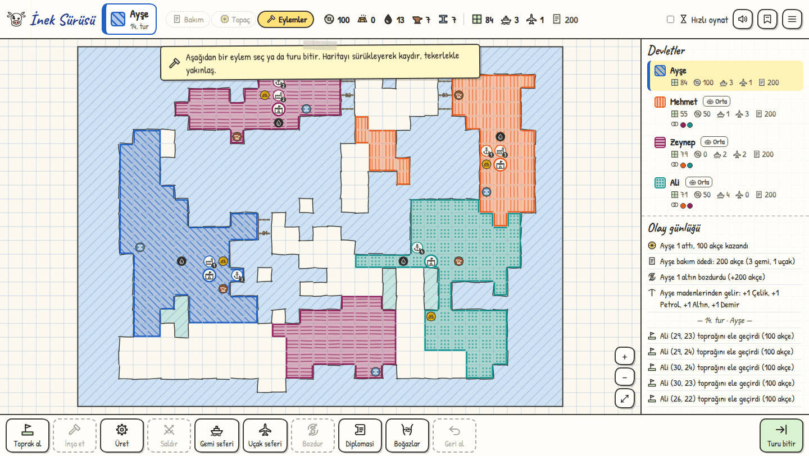
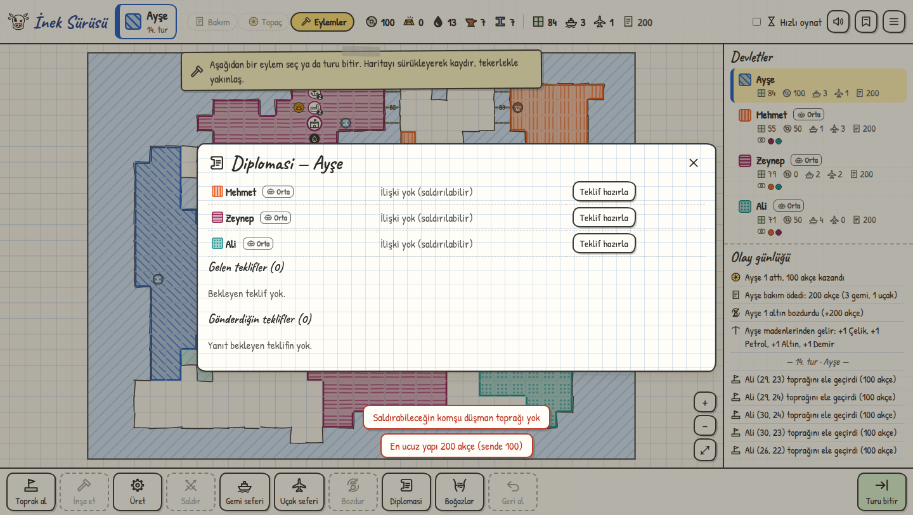
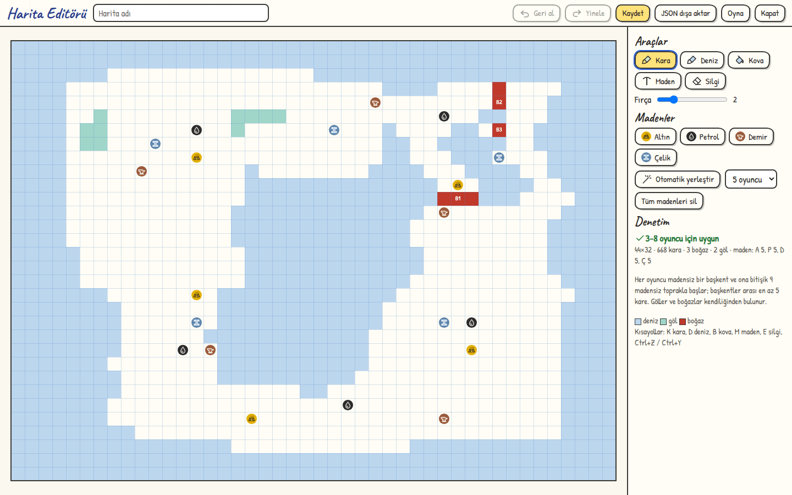
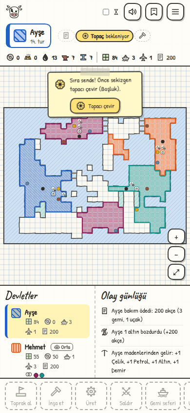

# İnek Sürüsü

<p align="center">
  
</p>

<h3 align="center">Kareli defterden çıkıp gelen, topaçlı strateji oyunu</h3>

<p align="center">
  <a href="https://www.typescriptlang.org/"></a>
  <a href="https://vite.dev/"></a>
  <a href="https://vitest.dev/"></a>
  <a href="docs/ONLINE.md"></a>
  
</p>

<p align="center">
  <b>Aynı ekranda · botlara karşı · arkadaşlarınızla çevrimiçi</b><br>
  Tarayıcıda çalışır; son kullanıcı için ayrı bir oyun sunucusu, hesap veya kurulum gerektirmez.
</p>

---

**İnek Sürüsü**, kareli bir haritada toprak alarak büyüdüğünüz, sekizgen topacın şansını
yönettiğiniz ve diplomasiyle dengeleri değiştirdiğiniz sıra tabanlı bir strateji oyunu.
Kurallar saf TypeScript ile yazılmış bağımsız bir motorda çalışır; arayüz yalnızca eylem
gönderir ve olayları canlandırır. Bu sayede oyun hem tarayıcıda akıcı kalır hem de aynı
kurallar testlerde, botlarda, çevrimiçi hakemlikte ve tekrar oynatmada birebir işler.

**İçindekiler:**
[Hikâye](#hikâye) ·
[Özellikler](#özellikler) ·
[Ekran görüntüleri](#ekran-görüntüleri) ·
[Hızlı başlangıç](#hızlı-başlangıç) ·
[Nasıl oynanır](#nasıl-oynanır) ·
[Kurallar](#kurallar) ·
[Oyun modları](#oyun-modları) ·
[Araçlar](#araçlar) ·
[Mimari](#mimari) ·
[Test ve denge](#test-ve-denge) ·
[Belgeler](#belgeler) ·
[Bilinen sınırlar](#bilinen-sınırlar) ·
[Katkı](#katkı)

## Hikâye

Bu proje bir ürün planıyla değil, kareli bir defterle başladı.

Çocukluğumda bir arkadaşımla aynı defterin sayfalarında oynadığımız bir oyun vardı.
Haritasını birlikte çizer, kurallarını birlikte uydurur, sırayla topacı çevirirdik.
Oyunun adı da o defterde doğdu: **İnek Sürüsü**. İsim bizim için hâlâ aynı şeyi taşıyor:
o iki çocuğun, o sayfaların ve birlikte kurduğumuz dünyanın hatırasını.

Yıllar sonra o defterdeki kuralları kaybetmemek için bu tarayıcı sürümünü yazdım.
Kareli kâğıt dokusu, el çizimi ikonlar ve dönen sekizgen topaç, o günkü hissi korumak
için. Kuralların belirsiz kaldığı yerlerde verdiğim kararlar
[`docs/ASSUMPTIONS.md`](docs/ASSUMPTIONS.md) dosyasında tek tek kayıtlı; böylece oyun hem
bugün oynanabilir hem de yarın tartışılabilir kalıyor.

Oyunun özgün fikri ve ilk kuralları iki kişinin ortak icadı. Bu depo, onu dijitalde
yaşatma çabası.

## Özellikler

| Özellik | Ne sunar? |
|---|---|
| **Sıra tabanlı strateji** | 3–8 oyuncu; topaç, akçe ekonomisi, fetih, yapılar ve birimler |
| **Üç oyun modu** | Aynı ekranda sırayla (hot-seat), botlara karşı ve çevrimiçi (WebRTC) |
| **Haritalar** | Tohumlanabilir rastgele üretim (kapalı denizler ya da takımada), dört hazır harita ve harita editörü |
| **Deniz ve hava** | Gemi ve uçak seferleri, boğaz geçişleri, askeri üs engelleri |
| **Diplomasi** | İttifak, süreli barış, akçe/kaynak/toprak takası, karşı teklif, boğaz izni, devletler arası borç |
| **Öğretici** | 11 konulu, adım adım, sabit senaryolu rehber |
| **Oyun tekrarı** | Her oyun deterministik; zafer ekranından veya dosyadan izlenebilir |
| **Test edilmiş motor** | 24 test dosyasında 281 Vitest testi; arayüzden bağımsız kural motoru |
| **Erişilebilirlik** | Renk körü dostu palet, klavye kısayolları, dokunmatik ve mobil düzen |
| **Bağımsız çalışma** | Statik dosya olarak yayınlanır; alt klasörde de çalışır |

## Ekran görüntüleri

<p align="center">
  <br>
  <sub><b>Oyun ekranı</b> — kareli harita, devlet panelleri, olay günlüğü ve eylem çubuğu</sub>
</p>

| Diplomasi | Harita editörü |
|:---:|:---:|
|  |  |
| Teklifler, ittifaklar ve ilişkiler | Kara, deniz, maden, göl ve boğaz çizimi |

<p align="center">
  <br>
  <sub>Telefon ve tabletlerde dokunmatik düzen</sub>
</p>

## Hızlı başlangıç

### Gereksinimler

- **Node.js 20.19+** (Vite 8 için; 22.12+ önerilir)
- **npm 10+**

### Kurulum

```bash
git clone https://github.com/halitbarut/InekSurusu.git
cd InekSurusu
npm install
npm run dev
```

Geliştirme sunucusu `http://localhost:5173` adresinde açılır. Üretim derlemesi:

```bash
npm run build      # tsc --noEmit + vite build → dist/
npm run preview    # dist/ çıktısını yerelde önizle
```

### Komutlar

| Komut | Ne yapar? |
|---|---|
| `npm run dev` | Geliştirme sunucusu (HMR ile) |
| `npm run build` | Tip denetimi + statik derleme (`dist/`) |
| `npm run preview` | Derlenmiş oyunu yerelde sunar |
| `npm test` | Kural motoru ve ağ testlerini bir kez çalıştırır |
| `npm run test:watch` | Testleri izleme modunda çalıştırır |
| `npm run simulate` | Denge simülasyonu → [`docs/BALANCE_REPORT.md`](docs/BALANCE_REPORT.md) (uzun sürer) |
| `npm run simulate -- --games 20` | Simülasyonu 20 oyunla hızlıca dener |
| `npm run simulate -- --round onayar` | Hazır kural takımlarını karşılaştırır |
| `npm run simulate -- --round zorluk` | Bot zorluk seviyelerini karşılaştırır |
| `npm run simulate -- --round ekonomi` | Yeni yapı fiyatları ve borç sistemini ölçer |
| `npm run simulate -- --round gercekci` | Gerçekçi botu ve kişilik farklarını ölçer |
| `npx tsx scripts/maps/build.ts` | Hazır haritaları ve öğretici haritasını yeniden üretir |
| `npx tsx scripts/maps/playtest.ts 4` | Hazır haritalarda bot oyunları oynatır |

`dist/` çıktısındaki bütün yollar görecelidir (`base: './'`); GitHub Pages gibi bir alt
klasörde de sorunsuz çalışır.

## Nasıl oynanır?

### 1. Oyunu kur

**Yeni oyun** ekranında 3–8 oyuncu ekleyin. Her koltuk için ad, renk ve **İnsan** ya da
**Bot** (Kolay / Orta / Zor / Gerçekçi) seçilir. Harita olarak rastgele üretim (boyut, seed ve kıta tipi
girilebilir, önizleme gösterilir), hazır haritalardan biri ya da harita editöründe
çizilmiş kayıtlı bir harita kullanılabilir.

Ardından her oyuncu sırayla **başkentini** seçer, sonra başkentine bitişik **9 toprak**
işaretler. Başlangıçta maden kareleri seçilemez; madenler oyun başladıktan sonra normal
sınır kuralıyla alınır. Başlangıç akçesi varsayılan olarak 0'dır; kural önayarı veya özel
ayarlarla değiştirilebilir.

### 2. Tur döngüsü

1. **Gelir:** Sahip olunan her maden, o tur için 1 birim ilgili kaynak verir.
2. **Bakım:** Gemi ve uçaklar için bakım ödenir; ödenemezse açık bakım penceresinden kapatılır.
3. **Topaç:** Ortada açılan büyük pencerede sekizgen topaç çevrilir; gelen sayı × 100 akçe kazanılır. Vadesi gelen borç bundan sonra kesilir.
4. **Eylemler:** İstenildiği kadar toprak alınır, yapı kurulur, üretim yapılır, sefer
   düzenlenir, diplomasi yürütülür ve turda en fazla bir savaş yapılır.
5. **Turu bitir:** Sıra bir sonraki oyuncuya geçer; elenenler atlanır.

### 3. Kazan

Dünyada tek bir devlet kalırsa o oyuncu kazanır. Kalan bütün devletler aynı ittifakta
ve oybirliğiyle oyunu bitirmeye karar verirse ittifak birlikte kazanır.

## Kurallar

### Ekonomi, yapılar ve birimler

| Eylem | Bedel | Koşul |
|---|---|---|
| Sahipsiz toprak al | 100 akçe | Toprağınıza komşu olmalı |
| **Tersane** | 400 akçe | Sahip olunan, denize kıyısı olan toprak (göl sayılmaz) |
| **Uçak fabrikası** | 600 akçe | Sahip olunan herhangi bir toprak |
| **Askeri üs** | 800 akçe | Sahip olunan, başkent olmayan toprak |
| **Yapı yıkma** | 100 akçe | Kendi yapın, kendi turunda; başkent yıkılamaz. Konuşlu birimler aynı türden başka yapıya taşınır, yoksa terhis edilir |
| **Terhis** | Ücretsiz | Kendi gemin ya da uçağın; geri ödeme yok, sonraki turdan bakımı ödenmez |
| **Gemi üret** | 2 demir + 100 akçe | Tersane gerekir; gemi tersanede konuşlanır |
| **Uçak üret** | 2 çelik + 200 akçe | Uçak fabrikası gerekir; uçak fabrikada konuşlanır |
| **Altın bozdur** | 1 altın = 200 akçe | Kendi turunuzda istediğiniz zaman |
| **Bakım** | Gemi 50 · Uçak 50 · Üs 0 akçe (varsayılan) | Her tur başında, topaçtan önce |

Bir karede en fazla bir yapı bulunur (başkent de yapı sayılır). Gemi ve uçaklar
kalıcıdır; her sefer yalnızca yakıt harcar. Tersane, uçak fabrikası ve başkent bakım
gerektirmez.

### Savaş

| Savaş | Kural | Masraf |
|---|---|---|
| **Kara savaşı** | Sınır komşuluğu gerekir. İki taraf topaç çevirir. `A > D` ise saldıran `A − D` toprak seçer; `A < D` ise savunan `⌈(D − A)/2⌉` toprakla karşı saldırır; `A = D` ise sonuçsuz | 100 akçe |
| **Askeri üs savaşı** | Saldıran art arda **2 kez** yüksek atmalı; eşitlikte atış tekrarlanır. Saldıran kaybederse toprak kaybetmez | 200 akçe + 1 demir |
| **Başkent savaşı** | Yalnızca karadan, sınır komşuluğuyla. Saldıran art arda **3 kez** yüksek atmalı; eşitlikte atış tekrarlanır | 600 akçe + 2 demir |

- **Turda yalnızca bir savaş** yapılabilir: kara savaşı, gemi/uçakla dolu toprağa saldırı,
  üs savaşı ve başkent savaşı aynı hakkı tüketir. Sonuç (eşitlik dahil) fark etmez.
  Sahipsiz toprak alma, inşa, üretim, bozdurma ve diplomasi sınırsızdır.
- Savaş masrafı savaş başlarken ödenir ve sonuçtan bağımsızdır. Gemi/uçakla saldırıda
  masrafa ek olarak yakıt ve varsa boğaz vergisi de aynı anda karşılanmalıdır.
- Fetihte başkent ve askeri üs toprakları seçilemez. Seçilen her toprak, seçim anında
  saldıranın toprağına komşu olmalıdır; böylece içeri doğru ilerlenebilir. Seçilecek
  toprak kalmazsa alınabildiği kadar alınır.
- **Başkent düşerse** savunan elenir; bütün toprakları, yapıları, birimleri, kaynakları
  ve akçesi saldırana geçer. Eski başkent sıradan bir toprak olur.
- Karşı saldırıda toprakları **savunan** seçer. İnsan savunan için "Cihazı X oyuncusuna
  verin" ekranı gösterilir.

### Deniz ve hava seferleri

| Sefer | Yakıt | Menzil ve kural |
|---|---|---|
| **Gemi** | 1 petrol | Denize kıyısı olan topraklara, yalnızca deniz karelerinden. Göllere giremez; boğaz ayarları rotayı etkiler. Tersane karesi hangi deniz havzalarına kıyıysa gemi o havzaların hepsine çıkabilir |
| **Uçak** | 2 petrol | Haritadaki herhangi bir toprağa. Müttefik olmayan askeri üslerin 3 kare (Chebyshev) çevresine giremez ve oradan geçemez |

- Sefer hedefi **sahipsizse** 100 akçeyle alınır ve savaş sayılmaz; **sahipliyse** normal
  savaş kuralları uygulanır (sınır şartı aranmaz).
- Kendi toprağınız, müttefikler ve barış yapılan oyuncular sefer hedefi olamaz.
- **Maden kareleri** gemi veya uçakla doğrudan alınamaz; önce yanındaki toprak alınmalıdır.
- **Başkent**, gemi veya uçakla saldırı hedefi olamaz; başkent savaşı yalnızca karadan
  yapılır. Askeri üs kendi engel alanının içinde olduğu için üslere uçakla saldırılamaz.
- Sefer sonrası gemi tersanesine, uçak fabrikasına döner. Tersane veya fabrika el
  değiştirirse orada konuşlu birimler de yeni sahibine geçer.

### Boğazlar

Bir boğaz karesinin iki yanında **birbirinin tam karşısındaki iki kara kareye** sahip olan oyuncu
o boğazda **söz sahibidir**; çapraz duran kareler sayılmaz. Farklı çiftleri tutan birden çok söz sahibi
olabilir: gemi her birinden ayrı izin alır, her birinin vergisini öder. Söz sahipliği toprak el
değiştirdikçe anında güncellenir, söz hakkı kaybedilince ayarlar silinir. Her boğazın yanındaki simge söz sahiplerinin
rengini ve geçişin senin için durumunu gösterir: ✓ açık, ? sorulacak, ¤ vergili, ✕ kapalı.

**Boğazlarım** panelinden her oyuncu için dört ayar seçilir: **Sor** (varsayılan), **Açık**, **Vergili**
(miktarla), **Kapalı**. Rotası Sor durumundaki boğazdan geçen sefer önce söz sahibine sorulur; söz sahibi bu
seferlik izin verir (isteğe bağlı vergiyle), reddeder ya da kalıcı ayar yapar. Biri bile reddederse sefer yapılmaz,
ödeme alınmaz, yakıt harcanmaz; aynı boğazdan o tur yeniden sorulamaz. Vergi istenirse sefer sahibi onaylar ya da vazgeçer.
Rota önizlemesinde hangi boğazlar için izin sorulacağı görünür.

### Cevap süresi

Başka bir oyuncu yüzünden oyun kilitlenmez. Savaş sonucu gibi bilgilendirme pencereleri sıra sahibi dışındakilerde
kendiliğinden ya da tıklanınca kapanır, oyun onları beklemez. Gerçekten cevap gerektiren sorular varsayılan **60 saniye**
bekler (Maç ayarlarından değişir, tur süresi kapalıyken de işler); bekleyenler "Ali'nin cevabı bekleniyor – 45 sn" görür.

| Soru | Cevap gelmezse |
|---|---|
| Karşı saldırıda toprak seçimi | Orta bot mantığıyla seçilir |
| Diplomasi teklifi, borç, boğaz izni | Reddedilir |
| Zafer oylaması | "Hayır" sayılır |
| Bakım penceresi | Otomatik dağıtma kuralı uygulanır |

### Diplomasi

Teklifler tek tek ya da birleştirilerek gönderilebilir: **ittifak**, **belirli süreli
barış**, **akçe / kaynak / toprak transferi** ve **boğaz geçiş izni veya vergi muafiyeti**.
Gelen teklife **karşı teklif** yapılabilir (zincirde en fazla 2 kez).
Müttefiklere ve barış yapılan oyunculara saldırılamaz; müttefik askeri üsleri müttefik
uçaklarını engellemez. İttifak kendi turunuzda bozulabilir, ancak bozduğunuz tur eski
müttefike saldıramazsınız. Barış anlaşması süresi dolmadan bozulamaz.

Hot-seat oyununda insan bir oyuncuya teklif gönderilirse "Cihazı X oyuncusuna verin"
ekranı çıkar. Botlar hem teklif gönderir hem de gelen teklifleri değerlendirir.

### Borç

Devletler birbirine akçe borç verebilir. İsteyen miktar ve vadeyi söyler; veren reddeder ya da faizini (0 = faizsiz)
belirleyip kabul eder; borçlu son koşulları onaylar. Borç veren isteyen olmadan da teklif edebilir.

- **Basit faiz:** geri ödenecek toplam = miktar × (1 + oran). Erken ödemede de aynı toplam ödenir.
- **Vade** gelince borçlunun o turunda topaçtan sonra kesilir. Akçe yetmezse kalan, bitene kadar her turun topacından sonra
  kesilir; bu sürede borçlu herkese "borçlu" görünür.
- **Başkent düşerse** elenenin borç ve alacakları fatihe geçer.
- Ayrıntıları yalnızca iki taraf görür; oyuncu panelinde kendi borç ve alacakların vadeleriyle yazar.

Bakım ödenemediğinde açılan pencerede altın kısmi bozdurulur (açığı kapatacak en az altın önerilir), birimler tek tek
terhis edilir ve borç istenebilir; hepsi birlikte kullanılabilir, açık kapanınca **Devam** etkinleşir.

### İsteğe bağlı kurallar

Yeni oyun ekranından açılıp kapatılabilir ve kayda dahil edilir:

- **Zayıflık şartı:** Başkente saldırmak için savunanın toprak sayısı saldıranınkinin
  yarısından az olmalı.
- **Açılış barışı:** İlk N tur (varsayılan 5) oyuncu topraklarına saldırı yapılamaz;
  sahipsiz toprak almak serbesttir.
- **Savaş masrafları** ve **bakım** ayrı ayrı kapatılabilir. İkisi de kapalıyken oyun
  kâğıt sürümüne en yakın hâline döner.

### Kural önayarları

Yeni oyun ekranında önce bir önayar seçilir; varsayılan **Dengeli**dir. Bir değer
değiştirilince seçim kendiliğinden **Özel**e geçer. Özel ayarlar isim verilerek kaydedilir
ve sonra listeden seçilebilir.

| Önayar | Ne değişir? |
|---|---|
| **Klasik** | Kâğıt oyuna en yakın: savaş masrafı ve bakım yok, yapılar 200 / 300 / 400 akçe |
| **Dengeli** | Simülasyonlarla ayarlanmış varsayılanlar |
| **Hızlı** | Harita %80 boyutunda, 300 akçeyle başlangıç: oyun daha kısa sürer |
| **Sakin açılış** | Dengeli + ilk 5 tur saldırı yasağı; yeni oyuncular için |
| **Özel** | Bütün ayarlar katlanabilir gruplarda (Harita, Ekonomi, Savaş, Bakım, İsteğe bağlı kurallar) |

Bütün önayarlar **Kapalı denizler** kıta tipini kullanır: kara tek parça, harita kenarı kara, denizler kara içinde ayrı
havzalar ve birbirine yalnızca boğazlarla bağlı; göller de vardır. **Takımada** (Özel → Harita ve kurulum) eski adalı üreticidir.

## Oyun modları

### Aynı ekranda (hot-seat)

Bütün koltuklar insandır; sıra değişiminde "Sıra: X" ekranı gösterilir (ayarlardan
kapatılabilir). Gizli diplomasi teklifleri için cihaz ilgili oyuncuya verilir.

### Botlara karşı

Her botun seviyesi ayrı seçilir. Hiçbiri hile yapmaz: topaç sonuçlarını önceden göremez,
ek kaynak almaz, oyunun RNG'sine dokunmaz.

| Seviye | Davranış |
|---|---|
| **Kolay** | Daha az planlı, gelişigüzel oynar; kolay kandırılır |
| **Orta** | Dengeli yatırım, beklenen kazanca göre savaş, makul diplomasi |
| **Zor** | En yakın rakip başkentini hedefler, başkent savaşı için birikir, kendi başkentine dayanan düşmanı önce geri iter |
| **Gerçekçi** | En güçlüsü değil, insan gibi oynayanı: kişiliği (saldırgan, temkinli, tüccar, fırsatçı, sadık müttefik) ve hafızası var; kin tutar, öne geçene karşı ittifak arar, işine gelince ittifakı bozar, pazarlık eder, ara sıra hata yapar ve kısa sözler söyler |

Denge sonuçları: [`docs/BALANCE_REPORT.md`](docs/BALANCE_REPORT.md).

Bot hamleleri izlenebilir bir hızda oynanır; üst çubuktaki **Hızlı oynat** ile hızlandırılır.
Hızlı oynat açıkken botların yalnızca önemli olaylarının sesi çalar.

### Çevrimiçi

Herkes kendi cihazından oynar; **ayrı bir oyun sunucusu gerekmez**. Oyun, oda sahibinin
tarayıcısında çalışır (kurallar, zarlar ve botlar orada); diğer oyuncular tarayıcıdan
tarayıcıya WebRTC (PeerJS) ile bağlanır.

1. Oda sahibi **Çevrimiçi oyun → Oda kur** der. Bir oda kodu ve davet linki çıkar
   (`…/?oda=KOD`). Koltuklar "Davetli oyuncu" ya da "Bot" yapılır.
2. Katılanlar linke tıklar veya kodu girer; ad ve renk seçip boş koltuğa oturur.
   Oturmayanlar **izleyici** olur. Ayrı bir izleyici linki de vardır (`&izle=1`).
3. Oda sahibi **Oyunu başlat** der; boş davetli koltuklarda bot oynar.

- **Sohbet:** Genel kanal ve oyuncular arası özel mesajlar. Sohbet düğmesinde okunmamış
  rozeti ve hafif bir ses vardır; diplomasi penceresinden bir oyuncuyla tek tıkla özel
  sohbete geçilir. Özel mesajlar uçtan uca şifrelenir; oda sahibi, değiştirilmemiş oyunda
  bunları çözemez. İzleyiciler gizli teklifleri ve özel mesajları görmez. Sohbet geçmişi
  yeniden bağlanınca geri gelir; oda sahibi izleyici sohbetini kapatabilir.
- **İzleyiciler:** Haritayı, oyuncuları, günlüğü ve genel sohbeti görür; genel kanala
  yazabilir. İzleyici listesi lobide ve oyunda görünür. Elenen oyuncu oyundan çıkmak
  zorunda kalmaz, izleyiciye dönüşür.
- **Bağlantı kopması:** 1 dakika beklenir; dönmeyen oyuncunun yerine bot oynar (bekleyen soruları cevap süresine tabidir). Aynı
  tarayıcıdan aynı linkle dönüldüğünde koltuk geri alınır.
- **Oda sahibi ayrılırsa** oyun durur; her tur sonunda oda sahibinde otomatik kaydedilen
  oyun daha sonra yerel olarak sürdürülebilir.
- İlk eşleşme için PeerJS'in ücretsiz bulut sunucusu kullanılır; bağlantı kurulduktan
  sonra veri doğrudan tarayıcılar arasında akar.
- Yerel ağda denemek için `npm run dev -- --host` yeterlidir. İnternetten katılacaklar
  için derlenmiş sayfanın herkese açık bir adreste yayınlanması gerekir.

Mimari, güvenlik modeli ve bilinen kısıtlar: [`docs/ONLINE.md`](docs/ONLINE.md).

### Öğretici

Ana menüdeki **Öğretici**, küçük ve sabit bir haritada, sabit bir seed ve iki botla
oynanan adım adım bir senaryodur. 11 konu sırayla işlenir: topaç ve gelir, toprak alma,
madenler ve altın bozdurma, inşa, üretim ve bakım, normal savaş, gemi ve uçak seferi,
boğazlar, askeri üs ve başkent savaşı, diplomasi ve kazanma koşulu. Her adımda kısa bir
açıklama, haritada vurgulanan bir hedef ve tek bir eylem vardır. Öğreticiden her an
çıkılabilir; ana menüden kaldığı yerden sürdürülür. Oyunu ilk kez açan oyuncuya ana
menüde önerilir.

## Araçlar

### Arayüz ve geri bildirim

- **Kare menüsü:** Bir kareye tıklamak, o karede yapılabilecek eylemleri maliyetleriyle
  gösterir. Yapılamayanlar soluk görünür ve nedeni yazar (ör. "Yetersiz demir: 1 demir
  daha lazım").
- **Savaş öncesi önizleme:** Masraf, kazanılırsa alınabilecek toprak sayısı, kaybedilirse
  karşı saldırı riski ve başarı olasılığı gösterilir (normal savaşta yaklaşık %44, başkent
  savaşında 1/8, üs savaşında 1/4).
- **Sefer rotası:** Gemi veya uçak hedefinin üzerine gelince rota haritada çizilir;
  geçilecek boğazlar, söz sahipleri, vergiler ve sorulacak izinler yazar.
- **Eylem sonrası:** Kaynak değişimleri kısa süre uçan sayılarla, değişen kareler kısa
  parlamayla, önemli olaylar sağ kenarda bildirimlerle görünür.
- **Tur hatırlatmaları:** Kullanılmamış savaş hakkıyla tur bitirilirken hafif bir hatırlatma
  çıkar; ilk oyunlarda bir eylem ilk kez yapılabilir olunca kısa bir ipucu gösterilir.
  İkisi de ayarlardan kapatılabilir.
- Üst çubukta sıradaki oyuncu, turun aşaması (Bakım → Topaç → Eylemler) ve tur süresi
  açıksa kalan süre görünür.

### Kaydet / yükle

Oyun her tur sonunda otomatik kaydedilir (ana menüde **Devam et**). Üst çubuktaki kaydet
düğmesiyle adlandırılmış kayıt oluşturulur veya oyun JSON olarak dışa aktarılır. JSON
dosyası **Kayıtlı oyunu yükle** ekranından içe aktarılır. Kayıtlar tarayıcının
`localStorage` alanında tutulur; kayıtlı oyun haritanın kendisini de içerdiği için harita
silinse bile açılır.

### Geri alma

Kendi turunuzda yaptığınız toprak alma, inşa, üretim, altın bozdurma, terhis, yapı yıkma, bakım ödemesi,
erken borç ödemesi, boğaz ayarı ve sahipsiz toprağa (izin gerektirmeyen) sefer **Geri al** düğmesi ya da `Ctrl+Z` ile geri
alınabilir. Topaç, savaş (savaşa dönüşen sefer dahil) ve diplomasi geri alınamaz; bunlardan
biri yapılınca o ana kadarki geçmiş silinir. Böylece kimse savaş sonucunu görüp önceki
hamlelerini değiştiremez.

### Oyun tekrarı

Her oyunun başlangıç durumu, seed'i ve uygulanan bütün eylemleri kaydedilir (geri alınanlar
hariç); kayıt oyunu birebir yeniden üretir. Zafer ekranında **Oyunu baştan izle**:
oynat/duraklat, ileri/geri adım, 1×–8× hız, tur çubuğuyla istenen tura atlama ve
tekrarla birlikte ilerleyen olay günlüğü. **Replay indir** ile dosya alınır, ana menüde
**Replay aç** ile yüklenir.

### Oyun sonu özeti

Zafer ekranında tur tur toprak ve akçe grafikleri (elenmeler işaretli), her oyuncunun
harcama dökümü, kazandığı ve kaybettiği savaşlar ile başkent savaşı denemeleri gösterilir.
Özet JSON olarak indirilebilir.

### Tur süresi

**Maç ayarları**nda isteğe bağlı tur süresi: kapalı (varsayılan), 1, 2, 3 veya 5 dakika.
Hot-seat'te ve çevrimiçide çalışır (çevrimiçide süreyi oda sahibi tutar). Son 15 saniyede
uyarı ve tık sesi duyulur. Süre dolunca topaç çevrilmemişse çevrilir, bekleyen zorunlu
seçimler Orta bot mantığıyla yapılır ve tur biter. Başkasının cevabı beklenirken sıra sahibinin süresi durur.

### Ses

Bütün sesler tarayıcıda Web Audio ile sentezlenir; ses dosyası yoktur. Topaç, toprak alma,
inşa, üretim, savaş, başkent düşüşü, tur değişimi, gelen teklif ve düğme tıklamaları
seslendirilir. Ses düzeyi ve sessiz mod ayarlardadır; oyun içinde üst çubukta da ses
düğmesi vardır.

### Harita editörü

Ana menüdeki **Harita Editörü** ile boş bir kâğıt veya rastgele bir harita üzerinden
çizim yapılır: kara/deniz fırçası, kova, maden yerleştirme (altın, petrol, demir, çelik;
isteğe bağlı otomatik dengeli yerleşim) ve silgi. Editörün kendi geri al/yinele desteği
vardır (`Ctrl+Z`, `Ctrl+Y`). Kapalı küçük su kütleleri kendiliğinden göl, dar geçitler
boğaz olur. Denetim paneli haritanın kaç oyuncuya uygun olduğunu ve varsa sorunları
gösterir. Haritalar isimle kaydedilir, önizlemeli listede düzenlenir, silinir ve JSON
olarak dışa/içe aktarılır.

### Hazır haritalar

Oyunla dört harita gelir; yeni oyun ekranında küçük önizlemeli kartlardan seçilir. Hazır
haritalar silinemez; **Kopyasını düzenle** ile kendi haritalarınıza kopyalanır.
Ayrıntılar: [`docs/MAPS.md`](docs/MAPS.md).

| Harita | Boyut | Oyuncu | Öne çıkan |
|---|---|---|---|
| **Anadolu ve Balkanlar** | 64×40 | 5–7 | İstanbul ve Çanakkale boğazları, Marmara, Ege adaları, Karadeniz, Akdeniz, Kerç Boğazı |
| **Takımadalar** | 46×32 | 3–4 | Ev adaları; altın ve çelik ortadaki atolde, gemi olmadan büyümek zor |
| **Büyük kıta** | 70×46 | 8 | Boğazla açılan iç deniz, kapalı iç deniz, beş göl |
| **İkiz kıtalar** | 58×36 | 4–6 | İki kıtayı ayıran kanaldaki iki dar boğaz, okyanusların tek bağlantısı |

### Kısayollar ve erişilebilirlik

| Kısayol | İşlev |
|---|---|
| `Boşluk` | Topacı çevir (pencere küçükken de) |
| `Esc` | Menüyü veya eylemi iptal et |
| `Ctrl+Z` | Son eylemi geri al |
| `Ctrl+Y` (editör) | Yinele |
| `1`–`6` | Kareye bağlı eylemleri seç |

Harita sürüklenerek kaydırılır, tekerlek veya iki parmakla yakınlaştırılır. Bir kareye
tıklamak, o karede yapılabilecekleri maliyetleriyle gösteren küçük bir menü açar;
yapılamayan seçenekler soluk görünür ve nedeni yazar. Renk paleti renk körü dostudur;
mobilde dokunmatik düzen ve büyük hedefler kullanılır.

## Mimari

```
src/
  engine/            Saf TypeScript kural motoru (DOM yok)
    types.ts         GameState, Action, GameEvent
    config.ts        Ayarlanabilir kural değerleri
    rng.ts           Tohumlanabilir RNG (mulberry32)
    rules.ts         validateAction / applyAction / dispatch, tur akışı, savaş, eleme
    combat.ts        Topaç ve savaş hesapları
    movement.ts      Gemi (deniz + boğaz) ve uçak (üs engelli) rota bulma
    diplomacy.ts     Teklif doğrulama ve uygulama
    helpers.ts       İlişkiler, boğaz söz sahipliği, fetih adayları
    loans.ts         Borç: faiz, vade, kademeli tahsilat, devir
    ledger.ts        Oyuncuların birbirine yaptıkları (botların hafızası)
    migrate.ts       Eski kayıtların güncel biçime çevrilmesi
    queries.ts       Arayüz ve botlar için geçerli hedef sorguları
    presets.ts       Hazır kural takımları
    undo.ts          Tur içi geri alma geçmişi
    replay.ts        Kayıt, yeniden oynatma, gizli tekliflerin ayıklanması
    actionShape.ts   Ağdan/dosyadan gelen eylemlerin biçim denetimi
    stats.ts         Tur sonu istatistikleri ve oyun sonu özeti
    map/             Harita üretimi, boğaz/göl tespiti, ASCII ve özel haritalar
  bot/               BotBrain, Kolay/Orta/Zor/Gerçekçi bot, hazır sözler, süre dolunca otomatik kararlar
  net/               Çevrimiçi oda: protokol, PeerJS taşıyıcı, HostRoom, ClientRoom, sohbet
  maps/              Hazır haritalar (scripts/maps ile üretilir)
  tutorial/          Sabit senaryo, adımlar ve rehber
  ui/                Canvas harita, topaç, paneller, ekranlar, ses, kayıt
    game/            Oyun ekranı, kare menüsü, topaç penceresi, tur saati, cevap süreleri, sohbet, ipuçları, özet
    replay/          Tekrar oynatıcı
    screens/         Ana menü, yeni oyun, harita editörü, çevrimiçi lobi
  main.ts            Uygulama girişi ve ekran yönlendirmesi
scripts/             Denge simülasyonu, harita üretimi ve bot oyun testleri
tests/               Vitest birim testleri
```

Tasarımın temel ilkeleri:

- **Tek ve serileştirilebilir durum.** Bütün oyun durumu `GameState` içindedir; RNG'nin
  iç durumu da buna dahildir. Kaydetme, tekrar oynatma ve ağ aktarımı aynı nesne
  üzerinden yapılır.
- **Eylem tabanlı motor.** Her eylem bir `Action` nesnesidir.
  `validateAction(state, action)` geçerliliği söyler; `applyAction(state, action, rng)`
  girdi durumunu değiştirmeden yeni durumu ve `GameEvent[]` olaylarını döner.
  `dispatch(state, action)` RNG'yi durumdan alıp geri yazan kısayoldur.
- **Tohumlanabilir rastgelelik.** Harita ve topaç sonuçları aynı seed ile birebir
  üretilebilir; bu, testleri, tekrar oynatmayı ve adil botları mümkün kılar.
- **Arayüzden bağımsız kurallar.** `engine/` DOM'a, Canvas'a veya ağa bağlı değildir.
  Arayüz yalnızca eylem gönderir ve dönen olayları canlandırır.
- **Botlar da aynı oyuncudur.** `BotBrain.chooseAction` aynı `Action` arayüzünü kullanır;
  seviyeler `MediumBot` üzerinden türetilir. Bot rastgeleliği oyunun RNG'sine dokunmaz.
- **Çevrimiçide oda sahibi hakemdir.** Katılanlar eylem ister; sonucu oda sahibi aynı
  motorla belirler ve her oyuncuya yalnızca görmesi gereken durumu gönderir.
- **Bağımlılıksız ön yüz.** Oyun çatısı, UI kütüphanesi veya oyun motoru yoktur; harita
  HTML5 Canvas, paneller sade HTML/CSS ile çizilir. Tek çalışma zamanı bağımlılığı
  çevrimiçi bağlantı için PeerJS'tir.

## Test ve denge

```bash
npm test
```

24 test dosyasında **281 test** bulunur. Kapsam başlıca şunlardır:

- Topaç, gelir, madenler, altın bozdurma ve tur akışı
- Kara savaşı, başkent savaşı, askeri üs savaşı, karşı saldırı ve eleme
- Gemi ve uçak rotaları, menzil, üs engeli, boğaz kuralları
- Kurulum, toprak seçimi, fetih adayları ve kazanma koşulu
- Diplomasi teklifleri, geri alma, istatistikler ve oyun tekrarı
- Kapalı denizler üreticisi, boğaz söz sahipliği ve izinleri, cevap süreleri, yapı yıkma, bakım ekranı ve borç
- Botlar (Gerçekçi bot dahil), önayarlar, harita editörü, hazır haritalar ve öğretici
- Çevrimiçi protokol, izleyiciler, sohbet ve güvenlik denetimleri

Denge çalışmaları gerçek bot oyunlarıyla ölçülür:

```bash
npm run simulate -- --games 20          # hızlı deneme
npm run simulate                        # tam simülasyon (uzun sürer)
npm run simulate -- --round 2           # yeni varsayılanlar ve karşılaştırma
npm run simulate -- --round 3           # dengeli madenler, küçük harita
npm run simulate -- --round onayar      # kural önayarları
npm run simulate -- --round zorluk      # bot seviyeleri
npm run simulate -- --round ekonomi     # yapı fiyatları ve borç
npm run simulate -- --round gercekci    # Gerçekçi bot ve kişilikler
```

Sonuçlar, varsayımlar ve öneriler [`docs/BALANCE_REPORT.md`](docs/BALANCE_REPORT.md)
dosyasına yazılır. Hazır haritalar ayrıca `scripts/maps/playtest.ts` ile önerilen en az
ve en çok oyuncu sayısında botlara karşı doğrulanır.

## Belgeler

| Belge | İçerik |
|---|---|
| [`docs/ASSUMPTIONS.md`](docs/ASSUMPTIONS.md) | Kural belirsizliklerinde verilen kararlar ve gerekçeleri |
| [`docs/BALANCE_REPORT.md`](docs/BALANCE_REPORT.md) | Simülasyon sonuçları, denge ölçümleri ve öneriler |
| [`docs/MAPS.md`](docs/MAPS.md) | Hazır haritaların tasarımı, doğrulaması ve bot oyunları |
| [`docs/ONLINE.md`](docs/ONLINE.md) | Çevrimiçi mimari, protokol, güvenlik ve kısıtlar |
| [`docs/UI_REVIEW.md`](docs/UI_REVIEW.md) | Arayüz incelemesi ve önce/sonra ekran görüntüleri |
| [`docs/FEEDBACK_REVIEW.md`](docs/FEEDBACK_REVIEW.md) | Geri bildirim incelemesi ve sadeleştirme kararları |

## Bilinen sınırlar

- **Oda sahibi hilesine karşı koruma yoktur.** Kurallar ve zarlar oda sahibinin
  tarayıcısında çalışır. Bu, arkadaşlar arası oyunlar için bilinçli bir tercihtir.
- **Oda sahibi ayrılırsa çevrimiçi oyun durur.** Otomatik kayıttan yerel oyun olarak
  sürdürülebilir.
- **Kısıtlı ağlar:** WebRTC doğrudan bağlantısı bazı kurumsal ağlarda, simetrik NAT
  arkasında veya VPN'lerde kurulamayabilir. Varsayılan kurulumda TURN aktarıcısı yoktur;
  başka bir ağ (örneğin telefon hotspot'u) genellikle çözer.
- **Eşleşme sunucusu:** PeerJS'in ücretsiz bulut sunucusu erişilemezse yeni oda
  kurulamaz; kurulmuş bağlantılar sunucu düşse de sürer.
- **Sohbet şifrelemesi** oda sahibine karşı tam koruma sağlamaz; anahtarları oda sahibi
  dağıttığı için değiştirilmiş bir istemci araya girebilir. Değiştirilmemiş oyunda oda
  sahibi özel mesajları çözmez.
- **Özel mesaj güvenli bağlam ister:** `crypto.subtle` yalnızca `https://` veya
  `localhost` üzerinde çalışır. Yerel ağda `http://192.168…` ile açıldığında genel kanal
  çalışır, özel mesaj kapalı olur.
- Aynı tarayıcının iki sekmesi aynı odaya aynı kimlikle bağlanır ve birbirini düşürür;
  ikinci katılımcı için başka bir tarayıcı veya gizli pencere gerekir.

## Katkı

Proje kişisel bir hatıra projesi olsa da hata bildirimleri ve katkılar memnuniyetle
karşılanır. Katkı göndermeden önce:

1. `npm install && npm test` ile mevcut testlerin geçtiğini doğrulayın.
2. Kural değişikliklerini `engine/` içinde, arayüzden bağımsız tutun ve yeni davranış
   için test ekleyin.
3. Belirsiz bir kural noktasını değiştiriyorsanız kararı
   [`docs/ASSUMPTIONS.md`](docs/ASSUMPTIONS.md) dosyasına gerekçesiyle yazın.
4. Deterministik davranışı etkileyen değişikliklerde kayıt/tekrar uyumluluğunu göz önünde
   bulundurun.

Hata bildirimi için depoda [issue açabilirsiniz](https://github.com/halitbarut/InekSurusu/issues). Oyunun adı ve özgün kuralları iki
arkadaşın ortak icadıdır; bu isimle türev çalışmalar yapmadan önce lütfen iletişime geçin.

## Teşekkür

- Oyunun ilk kurallarını birlikte uydurduğumuz arkadaşıma; bu proje onunla başladı.
- Kuralların açıkça yazılmasını ve ölçülmesini mümkün kılan
  [Vite](https://vite.dev/), [TypeScript](https://www.typescriptlang.org/),
  [Vitest](https://vitest.dev/) ve [PeerJS](https://peerjs.com/) ekiplerine.
- Kareli defter hissine katkıda bulunan Patrick Hand ve Caveat yazı tiplerinin tasarımcılarına.

## Lisans

Bu depo kişisel bir projedir ve henüz bir açık kaynak lisansı içermemektedir. Kullanım,
dağıtım veya ticari kullanım için lütfen
[issue açın](https://github.com/halitbarut/InekSurusu/issues).
